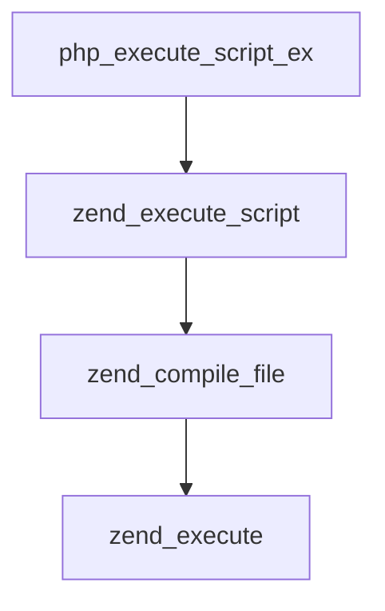

# 構成, 図, 引用のアンチパターン集

本ページのアンチパターンとは, AI エージェントが書きがちな, 文書の構成, 図, 引用の失敗の型である. 各項目は ID, 悪い例, 修正案の順に並べる.
文書を書き終えたら, 骨格, 図, 抜粋に似た失敗が残っていないか照合する.
文と用語の失敗例は `references/bad_statements.md` にある.

| ID | 軸 | 類型 |
|----|----|------|
| P1 | 構成 | 節の冒頭が経緯や予告 |
| P2 | 構成 | 課題と結論の不対応 |
| P3 | 構成 | 例の後の読み取りの欠落 |
| D1 | 構成 | 疑問に答えずに話題を進める |
| D2 | 構成 | 中身のない予告文 |
| D3 | 構成 | 見出しと主題の不整合 |
| X1 | 構成 | 根拠のない性質の主張 |
| H1 | 構成 | 免責が本論より先にある |
| E1 | 構成 | 具体例のない API 表 |
| G4 | 構成 | 前方参照の多用 |
| F1 | 図 | リード文と図の語の不一致 |
| F2 | 図 | 装飾の多い図 |
| F3 | 図 | 本文と別の内容の図 |
| M1 | 図 | 分岐のない mermaid |
| G1 | 図 | 図の右端のずれ |
| G2 | 図 | 識別子の衝突 |
| G3 | 図 | 文に近い図内の英語 |
| G7 | 図 | 定義位置と呼び出し位置の混在 |
| Q1 | 引用 | 関数全文の転載 |
| Q2 | 引用 | コードの言い換えだけの注釈 |
| Q3 | 引用 | 出典のない数値や主張 |
| C1 | 引用 | 唐突なコードブロック |
| G5 | 引用 | 作業環境のパス |
| G6 | 引用 | 出典の三重化 |

## P1 節の冒頭が経緯や予告

節の結論が末尾にあり, 冒頭が予告や経緯だと, 冒頭だけを読む読者は結論を得られない.
`outline_ja.py` は, `本節では〜を説明する` の形で始まる節を FAIL にする.

悪い例:

```
## 4段のページテーブル

ここでは, 4段のページテーブルの構造を見ていく.
まず, 平坦な配列の問題を振り返る.
(中略)
つまり, 4段のテーブルは使う範囲の表だけを確保できる.
```

修正案:

```
## 4段のページテーブル

4段のページテーブルは, 使うアドレスの範囲の表だけを確保する.
仮想アドレスの下位48 bit を, 9 bit ずつの4つの添字と 12 bit のページ内の位置に分け, 上位の添字から順に表を引く.
```

## P2 課題と結論の不対応

冒頭で立てた課題に, どの節も答えていないと, 読者は読み終えても結局なにかが分からない.

悪い例: 冒頭で `fork` の直後の書き込みが遅い理由を課題に置き, 本文は `fork` が複製する構造体の一覧で終わる.
書き込み時コピーと, それが起こすページフォールトを説明する節が無い.

修正案: 書く前に, 設計メモの6要素で課題の行と結論の行が対応するかを確かめる.
結論の節の冒頭文で, 課題の問いに直接答える.
`references/good_examples.md` の例5に修正例がある.

## P3 例の後の読み取りの欠落

例を示しただけで次の話題に進むと, 読者は例のどこを見れば主張を確かめられるかが分からない.

悪い例:

```
1, 2, 3 を順に挿入する.
(挿入ごとの木の図)

## 削除
```

修正案:

```
(挿入ごとの木の図)

3 を挿入した時点で赤が連続し, 回転の後に高さが 3 から 2 に下がった.
回転は, 色の規則を保ったまま木の高さを縮める.
```

## D1 疑問に答えずに話題を進める

悪い例:

```
通常の x86-64 ページは 4 KiB だが, 多数のページを扱うと
変換情報も大量に必要になる.
より大きな単位で対応付ければ, ページテーブルや TLB の負担を減らせる.
```

`変換情報` が何かも, なぜ大量に必要かも書かれず, 解決策に進んでいる.
小さいページの欠点が, 結論と理由の間に挟まっている.

修正案: 結論, 理由, 例, 補足の順に並べ, 疑問への答えを次の文に置く.
`references/good_examples.md` の例1に修正例がある.

## D2 中身のない予告文

悪い例:

```
両者は確保方法と失敗時の挙動が異なる.
```

違いを書かずに終わる. 予告した内容は同じ段で書く.

修正案:

```
HugeTLB は, 事前に予約したプールから確保する. プールが足りないと
確保に失敗する. THP は, 条件が合うときにカーネルが自動で割り当て,
合わなければ通常のページに戻る.
```

## D3 見出しと主題の不整合

悪い例:

```
# スケジューラアルゴリズム

## 待機解除と CPU の割り当ては別の処理
```

H1 の語が H2 以降に現れず, H2 は何の節か分からない命題になっている.
ページの冒頭に, 主題の定義, 扱う範囲, 節の構成がない.

修正案: 冒頭にスケジューラの定義と範囲を置き, 見出しは名詞句にする.
`references/good_examples.md` の例2に修正例がある.

## X1 根拠のない性質の主張

性質を主張する文には, 同じ節に根拠を書く.
根拠がないと, 読者は納得できず, 他の箇所にも応用できない.

悪い例:

```
赤黒木は, 二分探索木の高さを色の制約で O(log n) に抑える.
```

修正案:

```
各ノードから葉までの経路は, 同じ数の黒ノードを通る.
赤ノードの子は黒なので, 赤は連続しない. そのため最長の経路は,
最短の経路の2倍以下になる. 高さが要素数の対数に収まるのは, この性質による.
```

## H1 免責が本論より先にある

版差, ビルド設定, 範囲外の話題を主題の定義の直後に置くと,
読者は主題を理解する前に例外を読まされる.
本論の理解に必要でない注意は, 末尾の節に置く.

悪い例: `多段テーブル` の定義の直後に, 4段と5段の選択, `no5lvl`,
ビルド時固定の可否を15行書く.

修正案: 定義, 具体例, 仕組みの後に, 注意点の節を1つ設ける.
`references/good_examples.md` の例4に修正例がある.

## E1 具体例のない API 表

関数名の表を先に見せても, 読者はどの順で呼ぶのか分からない.
3要素の挿入など, 小さい例を手で追った後に, 例で使った関数を表にする.

悪い例: 図を1枚置いた直後に, `rb_link_node`, `rb_insert_color`,
`rb_erase` の役割を名詞止めで並べた表を置く.

修正案: 1, 2, 3 を順に挿入する例を示し, 各挿入で呼ぶ関数を文で説明する.
表は, その後に一覧として添える.

## G4 前方参照の多用

`後述` が多いと, 読者は定義を読む前に, 未定義の語を抱えたまま進む.
1つの節で2回以上使うときは, 順序を入れ替えるか, 初出の文で定義する.

悪い例:

```
`pipe_buffer` に有効範囲を設定する. 詳細は後述する.
状態の変化は後述の図で示す. 容量の変更は後述する.
```

修正案:

```
`pipe_buffer` は, ページと, ページ内の有効範囲を持つ配列の要素である.
この要素に有効範囲を設定すると, 読み取り側がデータを見つけられる.
```

## F1 リード文と図の語の不一致

本文と図で同じ対象を別の語で書くと, 読者は同じものかを判断できない.
`check_diagrams.py` は, 前後の段落に現れない図のラベルを INFO で示す.

悪い例: 本文は `head` と `tail` で使用中の範囲を説明し, 直後の図は同じ位置を `wp`, `rp` と書く.

修正案: 図のラベルを `head`, `tail` にする. 図にだけ現れる語は, 凡例で定義する.
`references/good_examples.md` の例6に修正例がある.

## F2 装飾の多い図

色, 絵文字, アイコンは, 主張に関係しない情報を増やし, 読者の注意を分散させる.
`check_diagrams.py` は, mermaid の中の絵文字とアイコンを FAIL にし, `classDef` などの色の指定を INFO で示す.

悪い例: すべてのノードの先頭に絵文字を付け, `classDef` でノードごとに別の色を塗る. 色の意味はどこにも書かれていない.

修正案: 絵文字と色を外す. 攻撃者が制御する値だけを区別したいときなど, 色に意味があるときだけ1色を使い, 凡例に意味を書く.

## F3 本文と別の内容の図

リード文と図が別の内容を描くと, 読者は図の目的を推測しながら読む.

悪い例: 本文は `write()` から `anon_pipe_write()` までの呼び出し経路を説明し, 直後の図は `pipe_inode_info` のメンバの配置を描く.

修正案: 図の主張を1文で決め, それをリード文にする. 経路の説明には経路図を, 構造の説明には配置図を置く.

## M1 分岐のない mermaid

分岐のない呼び出し経路は mermaid にしない. 縦に長くなり, 場所を取る.

悪い例:



修正案: 1段ごとに 2 文字のインデントで表す.

```
php_execute_script_ex()
  → zend_execute_script()
    → zend_compile_file()
      → zend_execute()
```

## G1 図の右端のずれ

枠の右端が1桁ずれると, 読者は区画の境界を誤る.
ASCII と孤立した `|` の検査では見つからない.
`check_diagrams.py` は, `|` の上下に枠線がない箇所を FAIL にする.

悪い例:

```
+------------------------+
| A: valid 4096 B         |
+------------------------+
```

修正案: 全行の右端の `|` を `+` と同じ列にそろえる.
文字数が違う行は, 空白で埋めて幅を合わせる.

## G2 識別子の衝突

状態の識別子 `[C0]` とページの識別子 `C` が同じ文字で始まると, 読者は別々の対象と気づけない.
1文字の識別子 (`A`, `B`) は, 別の用途の `A`, `B` とも区別できない.

悪い例:

```
[C1] F_SETPIPE_SZ(16384) complete
C: newly allocated
```

修正案: 状態は `[S0]`, 容量変更の状態は `[C0]`, ページは `PgA` のように, 系列ごとに接頭辞を分ける.
識別子は2文字以上にする.

## G3 文に近い図内の英語

図の中の英語が文になると, 読者は図と日本語の説明を行き来して読む.
ラベルは識別子か名詞句にし, 3語以内に収める. 語彙は `memory-layout.md` の表から選ぶ.

悪い例:

```
No pages for empty slots 2, 3
next loop iteration
prealloc: B still held
```

修正案: 図には `empty`, `head`, `PgB` などのラベルだけを書く.
意味は, 図の直後の凡例表に日本語で書く.

## G7 定義位置と呼び出し位置の混在

1つの図で, 右側の位置が定義位置にも呼び出し位置にもなると, 読者は位置の意味を取り違える.
但し書きの文で補うより, マーカーで区別する.

悪い例:

```
pipe2                 # fs/pipe.c:1152
  copy_to_user        # fs/pipe.c:1138
```

修正案:

```
pipe2                 # def fs/pipe.c:1152
  copy_to_user        # call fs/pipe.c:1138
```

マーカーは `def`(定義), `call`(呼び出し), `gen`(マクロの生成元) の3つである.

## Q1 関数全文の転載

関数の全文を貼ると, 読者はどの行が主張の根拠かを探すことになる.
`check_excerpt.py` は, 30行を超える抜粋を INFO で示す.

悪い例: `anon_pipe_write()` の全文を貼り, 直後に `この関数で追記する` とだけ書く.

修正案: 追記を判定する10行ほどを抜粋し, 省いた範囲を `/* 省略: 待機とシグナルの処理 */` と書く.
全文が必要なら, 版を固定した URL で示す.

## Q2 コードの言い換えだけの注釈

コードを日本語に言い換えた注釈は, コードを読めば分かることしか伝えない.
`check_excerpt.py` は, 10行以上で日本語の注釈が無い抜粋を INFO で示す.

悪い例:

```
ret = copy_page_from_iter(buf->page, offset, chars, from); /* コピーする */
if (ret < chars)                                            /* ret が chars より小さい場合 */
```

修正案:

```
ret = copy_page_from_iter(buf->page, offset, chars, from); /* (1) 利用者のバッファから, 末尾のページの空きへ書く */
if (ret < chars)                                            /* (2) 一部しか書けなければ, 有効範囲を伸ばさずに失敗を返す */
```

## Q3 出典のない数値や主張

出典と条件のない数値は, 読者が確かめることも, 自分の環境に当てはめることもできない.

悪い例:

```
この変更で, 書き込みは約30%速くなる.
```

修正案:

```
`perf bench sched pipe` を10回実行した中央値は, 変更前が 12.1 秒, 変更後が 8.4 秒である.
環境: Linux 7.2.8, x86-64, 8 コア.
```

## C1 唐突なコードブロック

悪い例: 別の話題の文章の直後に, 説明なしでコードブロックを置く.

```
(別の話題の文章)

(コードブロック)

syscall の lookup は値を userland の buffer にコピーする.
```

読者はコードの目的を知らずに読み始め, 認知を0から組み立てる.
後続の文にも `map value pointer` のような由来不明の語がある.

修正案:

```
map から値を取得する例を示す.
以下のコードは, `bpf` システムコールで bpf map から値を検索する.

(コードブロック)

`lookup.value` には, 検索結果を書き込む先のポインタを指定する.
kernel が検索結果を `value` に書き込む.
```

## G5 作業環境のパス

本文に作業環境の絶対パスがあると, 読者は再現できない. 作業の名前も漏れる.
`lint_ja.py --profile tech` は `/root/`, `/home/`, `/mnt/`, `/Users/` を FAIL にする.

悪い例:

```
ソースツリーは `/root/ws/some-ctf-2026/linux-7.2.8` である.
```

修正案:

```
対象: Linux 7.2.8
```

ツリーの場所は, frontmatter の `source_tree:` に置く.

## G6 出典の三重化

同じ行番号を, 図のコメント, 図の直後の箇条書き, 末尾の表に書くと, 更新時に食い違う.
出典は経路図のコメントに一本化し, 末尾の表には図に出ない定義だけを載せる.

悪い例:

```
(経路図の各行に fs/pipe.c:523 などのコメント)

根拠は次の位置にある.
- fs/pipe.c:523
- fs/pipe.c:617
```

修正案: 箇条書きを削る. 図のコメントだけで根拠を示す.
