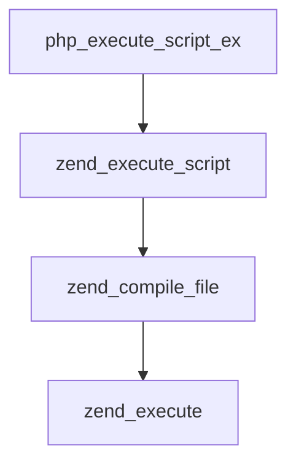

# アンチパターン集

AI エージェントが書きがちな日本語の失敗例. 各項目は ID, 悪い例, 修正案の順.
文書を書き終えたら, 似た言い回しが残っていないか照合する.

| ID | 類型 |
|----|------|
| T1 | 出所の分からない語 |
| T2 | 一般語を特殊な意味で使う |
| T3 | 英単語のサ変動詞化と名詞連鎖 |
| C1 | 唐突なコードブロック |
| N1 | 否定文の列挙 |
| M1 | 分岐のない mermaid |
| D1 | 疑問に答えずに話題を進める |
| D2 | 中身のない予告文 |
| D3 | 見出しと主題の不整合 |
| R1 | 参照先の不明な指示語, 擬人化 |
| S1 | 接続詞が消えた箇条書き |

## T1 出所の分からない語

悪い例 (kernel のドライバ開発で Codex が書いた文):

```
module exit は online flag を落とし, 全 probe を unregister して
grace period を待つ.
```

`module exit`, `online flag`, `probe`, `unregister`, `grace period` の
出所が不明で, 読者の認知負荷が増える.
語数を削った結果, 日本語として成立していない.

修正案:

```
`rmmod` などのドライバアンロード時に, `module_exit` 内で
`unregister_probes()` を呼び出す. この関数は以下を行う.
1. グローバル配列 `probes[]` の `registered` な要素ごとに,
   - `tracepoint_probe_unregister()` を呼び出し,
   - `probes[i].registered` をクリアする.
2. `tracepoint_synchronize_unregister()` を呼び出し,
   非同期処理の完了を待つ.
```

由来不明の英単語が無く, コードと突き合わせられる.
処理を分けて箇条書きにしているので, 長くなっても読みやすい.

## T2 一般語を特殊な意味で使う

`transaction`, `registry`, `generation`, `shape` は,
OS やソフトウェア開発以外の文脈でも使う語で, 意味が文脈で変わる.
文書内で定義せずに使うと, 読者は別の意味に取る.

悪い例:

```
`SUBMIT_VERDICT` は ABI shape と reserved field を検証した後,
`event_id` と `generation` で scan registry を検索する.
存在しない transaction は `-ENOENT`, generation 不一致は `-ESTALE`
を返す.
```

`ABI shape` と `reserved field` は文中で説明されていない.
`ABI` は医学の足関節上腕血圧比検査の略とも読める.

修正方針: 文書内で各語の意味を一度定義し, 実在の構造体名,
関数名, フィールド名で置き換える.

## T3 英単語のサ変動詞化と名詞連鎖

悪い例:

```
seq は drop を含む emit 試行ごとに進む.
```

修正案:

```
`seq` は, イベントの書き込みを試みるたびに 1 増える.
書き込みに失敗した場合も増える.
```

`drop する`, `emit される`, `fold する` のように英単語に `する` を付けない.
名詞を3語以上連ねず, 述語を書く.

## C1 唐突なコードブロック

悪い例: 別の話題の文章の直後に, 説明なしでコードブロックを置く.

```
(別の話題の文章)

(コードブロック)

syscall の lookup は値を userland の buffer にコピーする.
```

読者はコードの目的を知らずに読み始め, 認知を0から組み立てる.
後続の文にも `map value pointer` のような由来不明の語がある.

修正案:

```
map から値を取得する例を示す.
以下のコードは, `bpf` システムコールで bpf map から値を検索する.

(コードブロック)

`lookup.value` には, 検索結果を書き込む先のポインタを指定する.
kernel が検索結果を `value` に書き込む.
```

## N1 否定文の列挙

悪い例:

```
`seq` は drop を含む emit 試行ごとに進み, `generation` は変更しない.
`event_id` は因果関係用で, ring 自身は採番しない.
device 情報は telemetry であり, authoritative な identity ではない.
UAPI に raw kernel pointer は含めない.
```

否定で終わる文が続くと, 結論が何かが分からなくなる.
次の問いで必要性を確認する.

- その否定文は主題を裏付けるか, 直前の文への補足か.
- 否定文を足すと読者は何を得るか. 読むのに必須の情報か.
- 読者の拡大解釈を牽制するだけなら, 直前文と同じ強度で書かない.

補足は `>` の引用で直前の文の直下に添える.
GitHub や Obsidian では危険度に応じて `> [!TIP]`, `> [!WARNING]`,
`> [!CAUTION]` を使い分ける.

```
これは入力値の存在を確認するための user-space 計算を示す.
> XFRM 経路を kernel で動的に実行した証拠ではないことに注意.
```

## M1 分岐のない mermaid

分岐のない呼び出し経路は mermaid にしない. 縦に長くなり, 場所を取る.

悪い例:



修正案: 1段ごとに 2 文字のインデントで表す.

```
php_execute_script_ex()
  → zend_execute_script()
    → zend_compile_file()
      → zend_execute()
```

## D1 疑問に答えずに話題を進める

悪い例:

```
通常の x86-64 ページは 4 KiB だが, 多数のページを扱うと
変換情報も大量に必要になる.
より大きな単位で対応付ければ, ページテーブルや TLB の負担を減らせる.
```

`変換情報` が何かも, なぜ大量に必要かも書かれず, 解決策に進んでいる.
小さいページの欠点が, 結論と理由の間に挟まっている.

修正案: 結論, 理由, 例, 補足の順に並べ, 疑問への答えを次の文に置く.
`references/good_examples.md` の例1を参照.

## D2 中身のない予告文

悪い例:

```
両者は確保方法と失敗時の挙動が異なる.
```

違いを書かずに終わる. 予告した内容は同じ段で書く.

修正案:

```
HugeTLB は, 事前に予約したプールから確保する. プールが足りないと
確保に失敗する. THP は, 条件が合うときにカーネルが自動で割り当て,
合わなければ通常のページに戻る.
```

## D3 見出しと主題の不整合

悪い例:

```
# スケジューラアルゴリズム

## 待機解除と CPU の割り当ては別の処理
```

H1 の語が H2 以降に現れず, H2 は何の節か分からない命題になっている.
ページの冒頭に, 主題の定義, 扱う範囲, 節の構成がない.

修正案: 冒頭にスケジューラの定義と範囲を置き, 見出しは名詞句にする.
`references/good_examples.md` の例2を参照.

## R1 参照先の不明な指示語, 擬人化

悪い例:

```
次に誰をどの CPU で動かすかを選ぶ必要がある.
```

`誰` が指す対象が不明で, 動作主が曖昧.

修正案:

```
スケジューラは, 実行可能なタスクのうちどれを, どの CPU で
実行するか決める.
```

`この`, `上記`, `該当` は, 指す対象が一つに決まるときだけ使う.

## S1 接続詞が消えた箇条書き

箇条書きにすると, 項目間の因果や対比が消える.
項目が並列でなければ, 文で書く.

悪い例:

```
- TLB のエントリ数は有限
- ページが小さいとミスが増える
- Huge Page を使う
```

修正案:

```
TLB のエントリ数は有限である. ページが小さいと, 1 エントリが
カバーする範囲が狭く, ミスが増える. そのため Huge Page を使い,
1 エントリの範囲を広げる.
```
