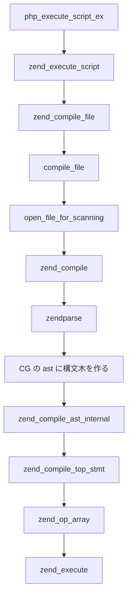

# AIエージェントがユーザに回答する場合や, ドキュメントを記述する際に避けるべき表現

以下は, 避けるべき日本語の文章をパターンとそのパターンの修正案を記述している. 
AI エージェントが日本語の文章を記述するときに, 似たような言い回しや表現を使用していないかチェックすること. 

## 使用している単語が何由来なのかわからない. 

以下の例は, kernelのDevice Driver開発でCodex が使用した文章である. 
この1文は, 使用している単語の由来がわからない. 

```
module exit は online flag を落とし, 全 probe を unregister して grace period を待つ.
```

5つの単語が出ているが, どの単語も引用元が不明確である. 

* `module exit`
* `online flag`
* `probe`     
* `unregister`
* `grace period`

文章の単語数だけを徒に切り詰めた結果, 日本語としておかしな文章を生成し, ユーザの認知負荷増加につながる. 

中身を読むと, 

* `module exit` は, `rmmod` 実行時に呼び出される, Device Driverの `module_exit()` マクロのこと. 
* `online flag` は, グローバル配列 `probes[]` の要素である `sensor_probe` 構造体の `registered` メンバのこと.  
* `probe` は, 同じくグローバル配列 `probes[]` のこと. 全 `probe` とは配列の全要素を指す. 
* `unregister` は, `unregister_probes()` を呼び出すこと. 
* `grace period` とは, カーネルの非同期処理が完了し, 同期的に安全に終了できるまでの期限のこと. 
  `tracepoint_synchronize_unregister()` というカーネル内の関数を呼び出す. 

つまり, 言いたいことは以下である. 
```
`rmmod`などのドライバアンロード時に, `module_exit` 内で `unregister_probes()` を呼び出し, 内部で以下の処理を行う. 
1. グローバル配列 `probes[]` の `registered` な要素に対して, 
  - `tracepoint_probe_unregister()` を呼び出し, 
  - `probes[i].registered` をクリアする.  
2. `tracepoint_synchronize_unregister()` を呼び出し, 同期的にドライバをアンロードできるまで待つ. 
```

これは, 由来不明な英単語が存在しない. 
`...` な部分は, コード中の変数, 関数名や構造体名であり, ユーザは説明を読む際に実際のコードと突き合わせられる. 
また, 文章としては長くなっているが, 処理の内容を分離して箇条書きにすることで, ユーザの認知負荷を上げにくい構造になっている. 

## 突然文中にコードブロックが現れる 
以下は BPF の解説資料作成中に Codex が作成した文章. 

```
... (別のトピックの文章) ... 

\`\`\`c
  uint32_t key = 0;
  uint64_t value = 0;
  union bpf_attr lookup = {
      .map_fd = map_fd,
      .key = (uint64_t)(uintptr_t)&key,
      .value = (uint64_t)(uintptr_t)&value,
  };
 
  if (syscall(SYS_bpf, BPF_MAP_LOOKUP_ELEM, &lookup, sizeof(lookup)) == -1) {
      perror("BPF_MAP_LOOKUP_ELEM");
  }
\`\`\`
 
syscall の lookup は値を userland の buffer にコピーする.
BPF helper の lookup は program が使える map value pointer を返す.
同じ「lookup」でも返すものが異なる.
```

突然 Code Block → 説明という流れだと, ユーザは一度そのCode Blockに対する認知を0から組み立てる必要があり, 認知負荷が高い. 

そのため, まずその Code Block で何を説明したいのか, Code Blockが何をしているのかを先に説明する. 

**修正案**
``` 
... (別のセクションの話し) ...

mapから値を取得するための実際の例を示す. 

以下のコードは, `bpf` システムコールを使用して,
bpf map から値を取得(lookup)するための処理を示している.

\`\`\`c
  ... (Cのコード)
\`\`\`
`lookup.value` には,検索結果の値を書き込むべきポインタをセットする.
これにより, `value` に対して, 検索結果の値が kernel から書き込まれる.
```

こちらは最初から唐突にコードを読者に投げつけるのではなく, まず次に示すコードが何をするのかを説明している. 
これにより読者は, 認知をコードを読む前に構築でき, 次のコードリーディングにスムーズに移行できる. 

また, 前者の例は, "`map value pointer`を指す" という用語も由来不明である. 
文体を圧縮するために, 会話内に閉じた英単語を造語するのではなく, 
文章を分割し, 実際のコードと突合できる形で処理内容を説明し, その結果どうなるのか？を日本語で記述する. 

## 一般的な用語を正しく定義せずに, 会話に閉じたSpecific Semanticsとして使用しない. 
`transaction`や, `registry`, `generation` といった用語は, 一般的な会話(OSやソフトウェア開発以外の文脈)でも使用する. 
そのため, Projectの文脈によって複数の意味やソフトウェアの挙動を定義しうる単語である. 
よって, このような単語が具体的に何を指しているのかは, 予め文書/回答内に定義されている必要がある. 

以下は Codex が実際に使用した文面である. 
```
`SUBMIT_VERDICT` は ABI shape と reserved field を検証した後, `event_id`と`generation`でscan registryを検索する.
存在しないtransactionは`-ENOENT`, generation不一致は`-ESTALE`を返す.
```
`SUBMIT_VERDICT`は, 独自デバイスドライバに実装された`unlocked_ioctl`の 第2引数に指定できるコマンド値のマクロである. 

この文書は, `ABI shape`と, `reserved field`という用語について, 文章内で一度も説明していない.
ABI shapeとは, 関数のシグネチャのことだろうか? 
人によっては, 足関節上腕血圧比（ABI）検査における脈波の形（波形：Waveform）のことと勘違いしてしまうかもしれない. 

そのため, そのドキュメント内で何をしているのか, 曖昧性無く定義すること. 

## 否定文を長々と列挙しない
結論の後に否定文を長々列挙するのは, ユーザの認知を阻害し, 説明を行う主体として読者に不誠実である. 

以下は Codex が実際に使用した文面である. 
```
`seq`はdropを含むemit試行ごとに進み, `generation`はring activityから変更しない.
`event_id`と`parent_event_id`はscan transactionとsuccessorの因果関係用で, ring自身は採番しない.

device / inode / mount metadataはuserspace向けserialized telemetryであり, 
kernel内部のauthoritative object identityではない. UAPIにraw kernel pointerは含めない.
```
> この文章も由来不明な用語が多数出現しているが, この例では言及しない. 

否定文で完了する文章が連続で出現しており, 結局何が言いたいのかわからない.
日本語の構成として, 以下のような言い回しが何度も続く文章は明らかに不自然である. 

例:
1. "~であり, ~でない."
2. "~である. ~ではない."

まず, その否定文が本当に必要か?批判的にレビューすること. 

* その否定文は主題や文章の結論を裏付けるものか? それとも直前文に対する補足や注意事項なのか? 
* エージェントが報酬ハックでトークンを無駄遣いするために記述しているものではないか?
* その否定文を入れることで, ユーザは何を得るのか？そのトピックを読むためになくてはならない情報か?

ユーザに直前文を拡大解釈させないための牽制である場合, それは直前文と同じ強度で書くべきではない.  
補足事項であることを, フォーマットとして示したうえで, 注意書きにするべき. 
例えば, markdownなら `>` を使用した引用を使い, 直前文章の直下に添える. 
また, github や obsidian ノートなら, `>[!Warning]` のような警告ダイアログを使うことができる. 
こちらは, 否定の強度(その解釈を持った場合の危険度) に対して, `>[!Tip]` / `>[!danger]` などを使い分けること. 

以下は実際に Codex が使用した例
```
これは入力値の存在を確認するuser-space計算であり,
XFRM経路をkernelで動的に実行した証拠ではない.
```

修正案
```
これは入力値の存在を確認するためのuser-space計算を示す.
> XFRM経路をkernelで動的に実行した証拠ではないことに注意. 
```

## mermaidによる図解表現で避けるべき表現
単純な分岐なしをmermaidの図にするべきではない. 

例えば以下は, codex が作成した mermaid図である. 

この図は php のコード実行パスを示しているが分岐がない.

mermaid 図はスペースを取るので,  単純なコード実行パスであれば, 以下のフォーマットのようにindentによる表現が好ましい.

修正案
```
php_execute_script_ex()
  → zend_execute_script()
    → zend_compile_file()
      → compile_file()
        → open_file_for_scanning()
          → zend_compile()
            → zendparse() ★ CG の ast に構文木を作る
              → zend_compile_ast_internal()
                → zend_compile_top_stmt()
                  → zend_op_array()
                    → zend_execute()
```
* 1段呼び出し毎に 2文字のスペースを空けること

尚, このコードの実行パスを Inline Block で表現する場合は, 1行あたり 70文字制限は無視して良い.  

