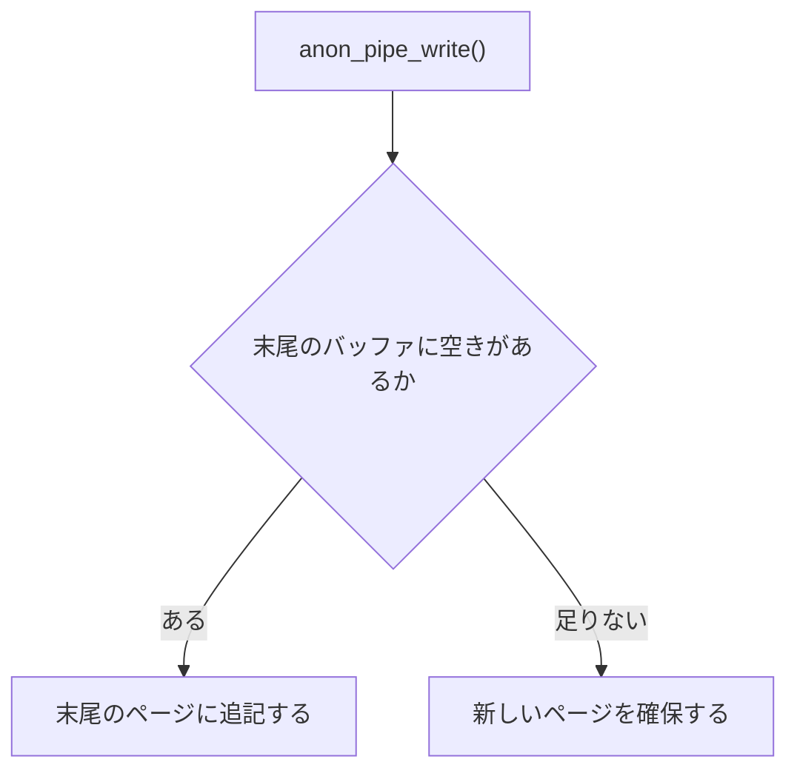

# 図と表の書き方

図とは, 文だけでは読者が頭の中で組み立てる必要のある関係を, 一目で見せるための補助である.
本ページは, 図を描く条件, 図とリード文の対応, 形式の選び方, 装飾の規則, 経路図の書き方を定める.
メモリ配置図と状態変化の図の詳細は `references/memory-layout.md` にある.

## 図を描く条件

図は, 次のどれかに当たるときに描く.

- 要素が4つ以上あり, 要素の間に関係がある.
- 時間の順序や, 主体の間のやり取りがある.
- 包含関係や, 変更の前後の比較がある.

1文で言える内容, 1つの関数の中身, 1つの値は, 文で書く.

## 1つの図に1つの主張

1. 描く前に, 図が示す主張を1文で決める. その1文を, 図のリード文にする.
2. 主張が2つあれば, 図を2つに分ける.
3. 図の領域やノードは10個までにする. 超えたら, 全体像の図と部分の図に分ける.

## リード文, 図, 読み取り文

図は, 前のリード文と, 後の凡例か読み取り文で挟む.

| 位置 | 書くこと |
|------|----------|
| 図の前 | 図が示す主張と, 読む向き(上から下, 左から右) |
| 図 | 主張に必要な要素と関係 |
| 図の後 | 凡例, または図のどこから何が言えるか |

1. 図のラベルは, リード文と本文で使った語と同じ表記にする.
   本文で `pipe_buffer` と書いたら, 図にも略さずに `pipe_buffer` と書く.
2. 図にだけ現れる語は, 凡例で定義する.
3. リード文を読んでから図を見た読者が, 同じ設計を説明していると分かる状態にする.
   `check_diagrams.py` は, 前後の段落に現れない図のラベルを INFO で示す.

3点の置き方を, パイプへの書き込みの分岐で示す.
`anon_pipe_write()` は, 末尾のバッファに空きがあればそのページに追記し, 空きが足りなければ新しいページを確保する.
次の図は, この分岐を上から下へ示す.



図の2つの枝は, 追記する場合と確保する場合に対応する.
同じページへの追記が続く間は, 使うページの数は一定に保たれる.

## 形式の選び方

図の形式は, 示す関係の種類で決める.

| 関係 | 形式 | 詳細 |
|------|------|------|
| 属性の比較 | 表 | 本ページの表の規則 |
| 分岐のない呼び出し経路 | 経路図(` ```text `) | 本ページの経路図の規則 |
| 条件による分岐 | mermaid の `flowchart` | 本ページの mermaid の規則 |
| 主体の間のやり取り, 時系列 | mermaid の `sequenceDiagram` | 本ページの mermaid の規則 |
| 状態の遷移 | mermaid の `stateDiagram-v2` | 本ページの mermaid の規則 |
| メモリ配置, 構造体, ポインタの参照 | ASCII の配置図(` ```text `) | `references/memory-layout.md` |
| 操作の前後の状態 | 同じ形式の図2つ | `references/memory-layout.md` |

## 装飾の規則

図は, 主張に必要な要素と関係だけで構成する.

1. 色, アイコン, 絵文字, 太字, 影を使わない.
2. 色を使うのは, 1つの意味(攻撃者が制御する値, など)を区別するときに限る. その意味を凡例に書く.
3. `subgraph` は, 包含関係を示すときに限って使う.
4. ラベルは, 名詞句か短い動詞句にする.
5. 矢印の意味は, 1つの図の中で1つに固定する.

`check_diagrams.py` は, mermaid の中の絵文字とアイコンを FAIL にし, `style`, `classDef`, `linkStyle` を INFO で示す.

## mermaid の規則

1. ノードの ID は ASCII にし, 表示する語はラベルに書く.
2. ノードのラベルは, 本文と同じ語にする. 識別子はそのまま書く.
3. 辺のラベルには, 条件か動作を書く.
4. 分岐のない流れは, 経路図か表で書く. `check_diagrams.py` は, 分岐のない `flowchart` を INFO で示す.
5. 向きは, 時間や呼び出しの順に合わせて `TD` か `LR` を選ぶ.
6. mermaid の図は等幅ではないので, ラベルに日本語を使ってよい.

## 経路図の規則

呼び出しの深さを2文字のインデントで表す. 同じ深さの行は, 呼び出し元へ戻ってから行う次の処理を表す.
右側に `# マーカー パス:行番号` を置く.

| マーカー | 意味 |
|----------|------|
| `def` | 関数の定義位置 |
| `call` | 経路上の呼び出し位置 |
| `gen` | マクロが関数を生成する位置 |

1. 1つの図に定義位置と呼び出し位置が混在してもよい. 区別はマーカーで示し, 但し書きの文は省く.
2. `#` は, その図で最も右まで伸びるコードの末尾から, 1文字空けた列に置く. 全行の `#` を同じ列にそろえる.
3. コメントの前の空白は, 1文字に抑える.
4. 分岐のない経路は, 経路図で書く. mermaid は分岐のある流れに使う.

`write()` からパイプのページへのコピーまでの経路は, 次のように書く.

```text
__x64_sys_write               # gen fs/read_write.c:747
  ksys_write                  # def fs/read_write.c:728
    vfs_write                 # def fs/read_write.c:667
      new_sync_write          # def fs/read_write.c:585
        anon_pipe_write       # def fs/pipe.c:523
          copy_page_from_iter # call fs/pipe.c:617
```

経路図の出典は右側のコメントに一本化する. 出典の書き方は `references/citations.md` に従う.

## 表の規則

1. 表の前に, 何を比べる表かを1文で書く.
2. 列は比較の軸にし, 行は比べる対象にする.
3. セルには短句を入れる. 名詞を3語以上連ねず, 長文も入れない.
4. 表は比較に使う. 列挙の形式は `references/writing_rules.md` に従う.

## 図の出所

1. 図の要素と関係は, 記憶ではなく, コード, 実行結果, 文献から作る.
2. 実装を描く図は, 要素の出典(`path:line`)を凡例か本文に書く. 経路図では, 右側のコメントが出典になる.
3. 論文の図を再構成するときは, 元の図番号を書く.
